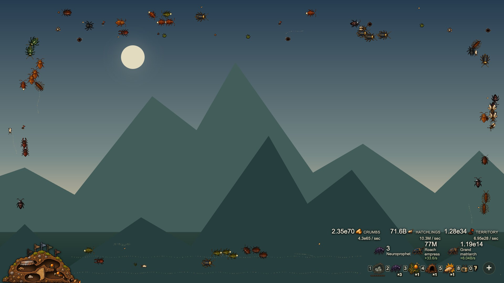
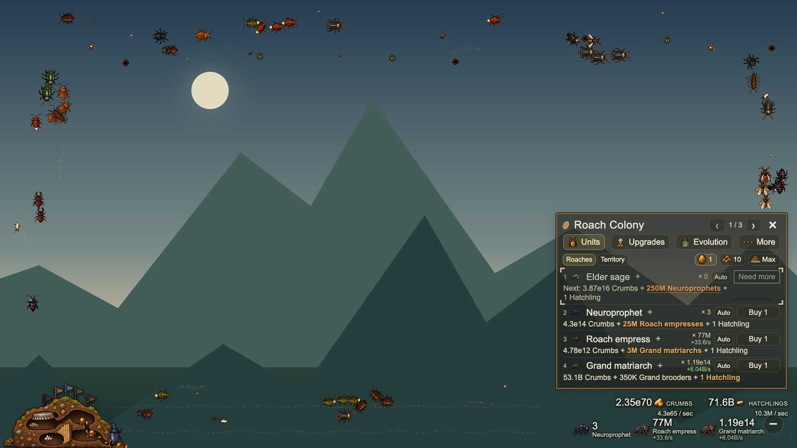
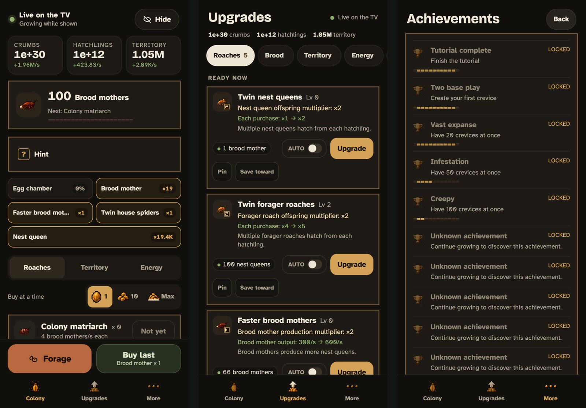

# Roach Colony

**An idle game that lives on the edges of your LG TV while you watch something else.**

Roach Colony is a transparent idle game overlay (an incremental game) for rooted LG webOS
TVs. A colony of pixel-art cockroaches forages, digs a nest and claims territory along the
borders of the screen, on top of YouTube, Netflix, live TV or whatever else is playing. The
centre of the picture stays clear. You grow the colony with the coloured buttons on the TV
remote, or from your phone. Its economy is a full port of the open-source
[Swarm Simulator](https://github.com/swarmsim/swarm), so it has the same long arc from a
few crumbs to numbers like 10^70 and beyond.

It runs as a homebrew web app through the webOS Homebrew Channel, and it was built and
tested on an LG CX OLED (webOS 5.6.2).



## Features

- **Plays over anything.** The page is transparent, so the colony walks the edges of the
  picture while the video keeps playing and keeps the remote.
- **Remote first.** Red forages and catches visitors, Green repeats your last purchase,
  Yellow opens the menus, Blue hides or shows the game, and the number keys buy quick
  picks. You never need a keyboard.
- **The whole Swarm Simulator economy.** It has 58 unit types, 88 upgrades and abilities,
  more than a hundred achievements, energy, territory and ascension with mutagen,
  translated into a cockroach theme.
- **Progress only while it is on screen.** The colony grows only while you can see it.
  Hiding it pauses everything, so it never nags you and never rewards leaving the TV on.
- **A living habitat.** Up to 64 representative roaches walk in lanes, carry crumbs home,
  queue at the nest door, greet each other and scatter when startled. The nest grows
  through six stages, and visiting insects wander by.
- **Chance events.** Golden roaches, egg cases, molting roaches, intruding spiders, snack
  drops and a night shift all run on visible time only.
- **Phone controller.** A small bridge on the TV lets any phone on the same Wi-Fi pair
  with a QR code and play from the couch. It is a home-screen web app with no install.
- **Easy on an OLED.** Text fades after a minute of inactivity, the overlay shifts a few
  pixels every few minutes, and a "critters only" level hides every label.
- **Light on the TV.** It has cached sprites, a capped canvas resolution, an adaptive frame
  rate (30, 20 or 15 fps) and a bounded number of walkers however large the colony gets.
  It is written in ES5 for the TV's Chromium 68.





## Requirements

- An LG TV running webOS with root access and the
  [webOS Homebrew Channel](https://github.com/webosbrew/webos-homebrew-channel) installed.
  [RootMyTV](https://rootmy.tv) and the guides at [webosbrew.org](https://www.webosbrew.org)
  cover rooting. Some firmware updates close the rooting exploits, so check that yours
  is supported before you update.
- SSH access to the TV (Homebrew Channel → Settings → SSH Server), with a host alias
  named `lgtv` in `~/.ssh/config`. The TV scripts copy files through it.
- [Input Hook](https://github.com/Simon34545/lginputhook) from the Homebrew Channel. It
  lets the coloured buttons and number keys reach the colony while another app, such as
  YouTube, has the remote.
- To build it on a computer: Node.js 20 or newer, npm and Python 3. The browser tests also
  need Google Chrome.

**Tested on:** LG OLED55CX (CX series, webOS 5.6.2, Chromium 68). Other rooted TVs on
webOS 5 or newer should work, but have not been tried. Reports are welcome.

## Install on your TV

1. **Build the app package.**

   ```sh
   npm ci
   npm run package        # writes dist/com.phil.roachcolony_<version>_all.ipk
   ```

2. **Install it.** Use either the Homebrew Channel's "Install from file", the webOS CLI
   (`npx ares-setup-device`, then `npx ares-install dist/*.ipk`), or the included helper:

   ```sh
   python3 scripts/tv/tv.py inspect     # read-only check that the TV is reachable
   python3 scripts/tv/tv.py install --playback-test-approved
   ```

   The helper reaches the TV through the `lgtv` SSH alias, and through telnet on the same
   address for Luna calls (set `ROACH_TV_HOST` to override that address). It installs the
   package but never launches it. The flag is a reminder to check that nobody is in the
   middle of watching something.

3. **Map the remote.** Copy `scripts/tv/blue-toggle.sh` and `scripts/tv/colony-key.sh` to
   `/var/lib/webosbrew/roach-colony/` on the TV. Then merge the bindings in
   [`scripts/tv/blue-keybind.json`](scripts/tv/blue-keybind.json) into Input Hook's
   `/home/root/.config/lginputhook/keybinds.json`, keeping a backup of the old file. Input
   Hook reloads its configuration without a restart.
   - Blue (code 401) shows or hides the colony.
   - Red, Green and Yellow (398 to 400), the digits 0 to 9 and the "…" key (994) are
     passed to the colony while it is on screen.
   - When the colony is not on screen, or it already has the remote, `colony-key.sh`
     sends the key back to the TV unchanged.

4. **Optional: the phone controller.**

   ```sh
   python3 scripts/tv/controller.py install --approved
   python3 scripts/tv/controller.py status
   python3 scripts/tv/controller.py rollback --approved   # removes it again
   ```

   On the TV, open the menu and choose More → Phone controller, then scan the QR code.

5. **Press Blue.** The colony appears over whatever is playing.

> **Do not reboot to fix things.** On a Developer Mode root, a reboot can remove homebrew.
> Nothing in this project needs a reboot, a Home restart or a compositor restart.

## How to play

A new colony starts dormant, like Cookie Clicker. Nothing grows until you act. Press
**Red** to forage. Ten crumbs and one hatchling buy your first Forager roach, and from then
on the nest hatches on its own. Buy more roaches to make more of the roaches below them.
Later you unlock territory, energy abilities and finally ascension, which trades your
colony for mutagen and permanent bonuses. Press **0** at any point for a hint drawn from
Swarm Simulator's original tutorial.

| Button | Action |
| --- | --- |
| Blue | Show the colony, or save and hide it |
| Red | Catch whatever is on screen (golden roach, intruder, egg case, molting roach, visitor), otherwise forage |
| Green | Repeat the last purchase |
| Yellow | Open the menus and cycle through them |
| 1–5 | Collapsed: buy the quick picks shown in the strip. In the menu, 1–4 buy the visible rows and 5 toggles auto-buy for the highlighted row |
| 6 | In the menu: cycle the quantity (1, 10, Max). Collapsed: pause auto-buy or repeat the last purchase |
| 7 | Jump to the row of the next goal |
| 8 | Collapsed: toggle Watch mode (only the hot bar stays). In the menu: details for the highlighted row |
| 9 | Show the shortcut help |
| 0 | Show a hint for your current stage |
| … | Open Achievements |
| Play / Pause, Stop | Resume or pause auto-buy, or clear it |
| CH+ / CH− | Turn menu pages |
| Arrows / OK / Back | Move, activate and close, as usual |

The overlay has three visible levels: the full management menu, compact (stock, census and
quick picks), and critters only (just the habitat). The quick picks are chosen from the
colony's state each moment: the next roach to aim for, the best upgrade and so on. Auto-buy
can be turned on for any row. It runs only while the colony is visible and waits quietly
for funds.

### Chance events

All events run on visible time and pay out in seconds of your current production.

| Event | How often | Reward |
| --- | --- | --- |
| Golden roach | Every 10–20 visible minutes | 5 minutes of crumbs and 2 of hatchlings |
| Visitor | Every 3–6 visible minutes, along one edge | 1 minute of crumbs the first time, and a log entry |
| Intruder | Every 15–30 minutes once you hold territory | Territory, up to 10 minutes' worth |
| Egg case, molting roach, snack drop | Every 10–20 visible minutes | 45–90 seconds of crumbs or hatchlings |
| Night shift | 22:00–06:00 on the TV clock | About 10% extra crumbs |

### Saves

The game saves to the TV's local storage, with a validated backup, and flushes the save
when you hide it. Use More → Export to copy a save and More → Import to restore one. More →
Reset progress starts a new colony after two confirmations. It keeps the old colony so you
can import it back.

## Try it in a browser

You can play without a TV. The local preview draws a simulated video behind the overlay.

```sh
npm ci
npm run preview
```

Open <http://127.0.0.1:8765/app/?preview=1>. In the preview, **R**, **G** and **Y** stand in
for the Red, Green and Yellow buttons, and the keyboard's digits work like the remote's
number keys. Press R about ten times to forage, then 1 to hatch your first forager roach.

## Development

```sh
npm ci
npm run setup:engine   # locked dependencies for the engine build
npm run build          # regenerates app/engine.js from the pinned Swarm Simulator source
npm test               # engine, saves, theme, chance events, session
npm run test:browser   # TV overlay UI in headless Chrome
npm run test:habitat   # renderer and walking-speed checks
npm run test:nest      # nest art
npm run test:controller
```

The tests never contact a TV. Set `CHROME_PATH` if Chrome is not in `/Applications`.
`ROACH_BRIDGE_NODE` runs the phone bridge test on a specific Node binary, such as the
TV's own 8.12. Screenshots and scratch output go to the ignored `work/` folder.

```text
app/                 The webOS app that becomes the IPK: overlay UI, habitat renderer, sprites
  swarm/             The Swarm Simulator port: adapter, pinned upstream source, generated engine
phone-controller/    The bridge that runs on the TV (Node 8.12, no dependencies) and the phone web app
scripts/
  build/             Engine bundle and sprite-atlas builders
  tv/                Install, probe and Input Hook scripts for the TV
  dev/               Benchmarks and balance simulations
tests/               Node and headless-Chrome test suites
art/                 Source pixel art for the creatures, nest, events and sheets
docs/                Design, balance, glossary, UI specification and naming
```

Start with [docs/design.md](docs/design.md) for how the parts fit together. Then read
[docs/ui-spec.md](docs/ui-spec.md) for the look and the controls,
[docs/balance.md](docs/balance.md) for the economy, and [docs/naming.md](docs/naming.md) for
how Swarm Simulator's names map to roaches. [AGENTS.md](AGENTS.md) holds the working rules
for anyone, human or AI, changing the code.

## How it works

The app is an ordinary webOS web app whose manifest asks for a transparent window, so the
video underneath stays visible. Input Hook catches the remote's coloured and number keys
before the foreground app does. A short shell script then hands each key to the colony as
a relaunch parameter, so YouTube keeps focus and playback is never interrupted. The phone
controller is a small Node server on the TV that relays a fixed set of commands over a
local WebSocket. It never runs the game itself. The game page stays the only authority, and
the bridge never writes its save.

## Credits and license

- The game economy, progression tables and tutorial text come from
  [Swarm Simulator](https://github.com/swarmsim/swarm) by Evan Rosson, under GPL-3.0. They
  are pinned and unmodified in `app/swarm/source/` (see
  [PROVENANCE](app/swarm/PROVENANCE.md)).
- The transparent overlay manifest is based on
  [Webos-EARC-Volume-Overlay](https://github.com/Nikolay1243/Webos-EARC-Volume-Overlay)
  (MIT).
- The fonts are Atkinson Hyperlegible and Bricolage Grotesque, under the SIL Open Font
  License. QR codes use [qrcode-generator](https://github.com/kazuhikoarase/qrcode-generator)
  (MIT).
- The full list is in [app/THIRD_PARTY.md](app/THIRD_PARTY.md).

Roach Colony is free software under the [GNU GPL v3](LICENSE).

---

*Keywords: LG webOS homebrew game, rooted LG TV, webOS overlay app, idle game for TV,
incremental game, Swarm Simulator port, LG CX OLED, webosbrew, RootMyTV, Input Hook,
TV remote game, ambient game, desktop pet for TV, pixel art cockroach game.*
